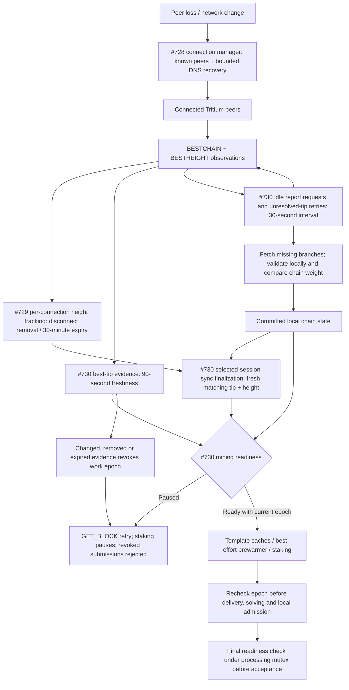

# Recent Changes Summary — Mining Infrastructure

**Version:** LLL-TAO 5.1.0+  
**Coverage:** PRs #502–#545 and #728–#730

**Last Updated:** 2026-11-06

---

This document catalogs all significant mining infrastructure changes for future
developers.  Changes are organized by area rather than chronologically.

---

## Peer Recovery and Mining Readiness (PRs #728–#730)

This series separates recovering connections, completing synchronization, and
being ready to produce blocks. A connected peer or a completed synchronization
is not sufficient evidence to keep public-network mining active.

### Changes by PR

| PR | Scope | What it does not guarantee |
|---|---|---|
| [#728](https://github.com/NamecoinGithub/LLL-TAO/pull/728) | Bounded, jittered DNS seed recovery and `peer_recovery` diagnostics; preserve live address state and record only successful refreshes. Fix outbound admission, connected-peer selection, immediate socket connection handling, and worker shutdown/wakeups. | Connectivity does not prove synchronization or chain quality. An OS DNS lookup can delay shutdown; independent direct connections do not share an atomic admission limit with the manager. |
| [#729](https://github.com/NamecoinGithub/LLL-TAO/pull/729) | Track heights per connection, remove disconnected observations, and expire heights after 30 minutes. Pair deferred `BESTCHAIN` handling with `BESTHEIGHT`; fix long Colin report lines and join reporting workers before teardown. | This increment alone does not pause isolated mining, reject stale work, or independently retry unknown shorter tips. |
| [#730](https://github.com/NamecoinGithub/LLL-TAO/pull/730) | Add fresh peer-backed mining readiness and epoch fencing, idle peer-tip retries and sync finalization, immature-credit deferral and orphan safety, and prewarmer coalescing/success accounting. | Peer agreement is not consensus. Multi-node partition/recovery acceptance testing and a clean full-suite result remain outstanding; not ready for live deployment. |

### Recovery and admission flow

On public networks, readiness requires completed initial sync, a consistent
committed tip, no shutdown/reorganization, and fresh support from two distinct
peer IPs by default. Resolve each advertised hash locally, verify the returned
block's hash and height, and require a main-chain block no more than two heights
behind the tip. Unknown/mismatched reports and locally known heavier branches
veto readiness; known non-heavier branches do not count as support.
`-miningminpeers=1` explicitly reduces the required evidence; values outside
1–16 fail closed. Local-development testnets can bypass peer and initial-sync
requirements, not shutdown/reorganization checks. Private/hybrid channel-3
production is unchanged.

Epochs are process-local, not serialized or trusted from network blocks.
Changed, disconnected or expired evidence and ready-to-paused transitions
revoke work; restoring readiness does not revive it. Both mining protocols,
caches, template publication, staking and local admission check current work.
Queued/sent bytes cannot be recalled, so stale submissions are rejected rather
than canceled by a new miner message. The 216-byte header and consensus block
format are unchanged.

With `-peerbestchainrecovery`, unknown tips, including shorter branches, are
retried at most once per 30 seconds until 30 minutes after the last best-chain
advertisement. Fetching is not activation: local validation and chain weight
remain authoritative. Height-only updates do not refresh best-tip evidence.

Immature coinbase credits and their dependent sigchain tails remain in the
bounded conflict pool for re-evaluation at the local chain height; peer heights
cannot make a credit mature. Missing-predecessor orphans are revalidated when
the predecessor arrives; no connected peer leaves the request queued safely.
Prewarmer work coalesces by channel/reward/tip while queued or in flight, counts
only non-null results, and releases keys after completion/failure/staleness.
A notification coalesced during a failed build does not schedule its own retry.

### Operator and verification notes

- Perform a full clean rebuild: `TritiumBlock` and `TritiumNode` memory layouts
  changed. Do not mix old and new objects.
- `system/get/info.peer_recovery` describes connection recovery;
  `mining_readiness` reports `ready`, `reason`, `epoch`, `fresh_peers`,
  `required_peers`, and `local_bypass`. Existing sync fields are unchanged.
- DNS controls and diagnostic meanings are documented in the
  [configuration reference](../../reference/nexus.conf.md#network-configuration).
- The review follow-up qualifies the nested readiness enum, explicitly checks
  peer block identity, adds mismatched-record regression coverage, and makes
  coinbase-maturity fixture cleanup RAII-based so failed assertions abort open
  transactions, undo mempool overlays and restore ledger/global state.
- See [known risks and limitations](known-risks-and-limitations.md) for current
  deployment restrictions. Core changes do not include Interface wallet/UI
  changes or wallet-specific acceptance tests.

---

## A. I/O & Performance (PRs #528, #540, #541, #543, #544)

### Compile-Time Type Dispatch (PR #528)

Replaced `dynamic_cast` with `constexpr` type check in the DataThread hot path.
The `dynamic_cast` was executed on every connection, every poll cycle — at 500+
connections with a 10 ms cycle, this was ~50,000 casts/second for zero benefit.

**Before:** `if (dynamic_cast<Miner*>(CONNECTION.get()))`  
**After:** `if constexpr (std::is_same_v<ProtocolType, Miner>)`

Files: `src/LLP/data.cpp`

### LLD shared_mutex (PR #540)

Changed `SectorDatabase::SECTOR_MUTEX` from `std::mutex` to `std::shared_mutex`.
Read paths (`Get`, `GetBatch`) now use `SHARED_LOCK` (concurrent readers allowed),
while write paths (`Update`, `Force`, `Delete`) use `WRITE_LOCK` (exclusive).

New macros in `src/Util/include/mutex.h`:
- `SHARED_LOCK(mut)` → `std::shared_lock<std::shared_mutex>`
- `WRITE_LOCK(mut)` → `std::unique_lock<std::shared_mutex>`

Files: `src/LLD/templates/sector.h`, `src/LLD/sector.cpp`, `src/Util/include/mutex.h`

### Configurable Mining Poll Timeout (PR #541)

Mining DataThreads now use **10 ms** poll timeout (vs 100 ms for P2P/API).
Configurable via `-miningpolltimeout`.  Defined in `mining_constants.h` as
`DEFAULT_MINING_POLL_TIMEOUT_MS = 10`.

Files: `src/LLP/include/mining_constants.h`, `src/LLP/data.cpp`

### Dedicated Epoll for Mining (PR #543)

Linux mining DataThreads now use `epoll` with 1 ms timeout and O(ready)
complexity.  Compile-time gated via `is_mining_data_thread_v` trait.  Falls back
to poll() on non-Linux platforms or `epoll_create1` failure.

Key components:
- `ThreadEpoll()` — dedicated event loop (~280 lines)
- `check_connection_health()` — shared between poll and epoll paths
- `epoll_register()` / `epoll_deregister()` — slot-indexed registration
- Health sweep every 250 ms (decoupled from I/O hot path)

Files: `src/LLP/templates/data.h`, `src/LLP/data.cpp`

See: [Linux Epoll Mining Architecture](linux-epoll-mining-architecture.md)

### FD Close-on-Exec Hardening (PR #544)

All socket and epoll file descriptors now use close-on-exec flags to prevent FD
leaks into child processes (e.g., `-blocknotify` handlers via `std::system()`):

- `epoll_create1(EPOLL_CLOEXEC)`
- `socket()` with `SOCK_CLOEXEC`
- `accept4()` with `SOCK_CLOEXEC` (+ `ENOSYS` fallback for older kernels)
- `fcntl(fd, F_SETFD, FD_CLOEXEC)` fallback on non-Linux

Files: `src/LLP/data.cpp`, `src/LLP/server.cpp`, `src/LLP/socket.cpp`,
`src/LLC/falcon/rng.c`, `src/Util/include/daemon.h`, `src/Util/filesystem.cpp`,
`src/LLC/x509_cert.cpp`

---

## B. Connection Stability (PRs #504, #507, #509–#512, #536–#537)

### Silent SUBMIT_BLOCK Drop (PR #504)

Fixed DDOS threshold on port 8323 that was too low, causing valid SUBMIT_BLOCK
packets to be silently dropped.  Added v0 logging for DDOS filtering on the
stateless lane (port 9323).

Files: `src/LLP/miner.cpp`, `src/LLP/stateless_miner_connection.cpp`

### Mining-Aware Send Buffer (PR #507)

Authenticated miners now get a **15 MB** send buffer (`MINING_MAX_SEND_BUFFER`)
instead of the default 1 MB.  This prevents buffer overflow disconnects during
heavy template push traffic.

Files: `src/LLP/templates/base_connection.h`, `src/LLP/include/mining_constants.h`

### Silent 1-Hour Drop (PRs #509, #510)

Two related fixes:

1. **PR #509:** POLL_EMPTY + TIMEOUT_WRITE were killing authenticated miners.
   Added exemptions for authenticated mining connections.
2. **PR #510:** Missing flush after `respond()` caused packets to sit in the
   write buffer until the next poll cycle.  Added explicit flush.

Files: `src/LLP/data.cpp`, `src/LLP/miner.cpp`,
`src/LLP/stateless_miner_connection.cpp`

### Buffer Latch Fix (PRs #511, #512)

1. **PR #511:** `fBufferFull` stale latch — CAS race in the Socket write path
   left the flag permanently set.  Fixed with `compare_exchange_strong`.
2. **PR #512:** Retry sleep in `respond()` blocked the DataThread.  Replaced
   with batch flush loop and proportional buffer reserve.

Files: `src/LLP/socket.cpp`, `src/LLP/templates/base_connection.h`

### Push Notification Decoupling (PR #536)

Template building was holding the socket mutex during the entire template
construction → serialization → write sequence.  This blocked other threads from
writing to the same connection for 1–5 ms per template.

**Fix:** Decouple template building from socket write.  Build the template
payload outside the mutex, then acquire the mutex only for the write.  Added
`DrainOutgoingQueue()` with move semantics and `fHasOutgoing` atomic flag for
lock-free HasQueuedPackets() checks.

Files: `src/LLP/templates/base_connection.h`, `src/LLP/miner_push_dispatcher.cpp`

### Shadow Ban Fix (PR #537)

Authenticated miners had an **infinite read-idle exemption** — they could never
be disconnected for inactivity.  This allowed zombie connections to accumulate.

**Fix:** Scoped read-idle timeout (600 s default, configurable via
`-miningtimeout`) + partial-packet watchdog (30 s).  Authenticated miners are
exempt from the *socket* timeout but not from the mining-specific read timeout.

Files: `src/LLP/data.cpp`, `src/LLP/include/mining_constants.h`

---

## C. Session Management (PRs #515–#535)

### SessionStore Consolidation (PR #530)

Replaced **9 separate session stores** with a unified `SessionStore` singleton
backed by `CanonicalSession` structs.  The `CanonicalSession` struct consolidates
all per-miner state: identity, connection, lifecycle, channel, auth/crypto,
reward, notifications, keepalive, and health tracking.

Files: `src/LLP/include/session_store.h`, `src/LLP/include/canonical_session.h`

### SessionRecoveryManager Removal (PR #532)

Removed the `SessionRecoveryManager` class entirely.  On disconnect, miners now
perform **full re-authentication** — simpler and more secure than session recovery.

Removed: `src/LLP/include/session_recovery.h`, `src/LLP/session_recovery.cpp`

### ActiveSessionBoard Removal (PRs #529, #535)

Removed the `ActiveSessionBoard` class.  Its health tracking fields
(`nFailedPackets`, `fMarkedDisconnected`, `nLastSuccessfulSend`) are now inline
in `CanonicalSession`.  The `Register()` method was discovered to be dead code
(never called on the push path).

Removed: `src/LLP/include/session.h` (ActiveSessionBoard parts)

### AutoCooldownManager (PR #535)

Replaced permanent DDOS bans with **auto-expiring cooldowns**.  The
`AutoCooldownManager` singleton manages per-miner cooldown windows
(`nCooldownExpiry` in `CanonicalSession`) that automatically clear after a
configurable duration.

Files: `src/LLP/include/auto_cooldown_manager.h`

### TOCTOU Race Fixes (PR #531)

Fixed unsigned underflow and unbounded growth bugs in session cache operations.
Added `CompareAndErase()` for atomic remove-if-matches operations, and
re-read-before-delete guards in sweep functions.

Files: `src/LLP/include/session_store.h`

### Canonical Registry Live/Inactive Split (PR #546)

`NodeSessionRegistry` now separates **live runtime sessions** from **inactive
cache entries**.  Periodic maintenance enforces capacity only on the inactive
cache, while active miners remain non-evictable runtime state.  Legacy and
stateless disconnect paths now demote only their own exact endpoint/lane, and
inactive canonical sessions are preserved for later re-authentication.

Files: `src/LLP/node_session_registry.cpp`, `src/LLP/stateless_manager.cpp`,
`src/LLP/miner.cpp`, `src/LLP/stateless_miner_connection.cpp`

---

## D. Protocol Hardening (PRs #502–#503, #515–#521)

### SUBMIT_BLOCK Mutation Fix (PR #502)

Pre-validation of submitted blocks was mutating `hashMerkleRoot`, invalidating
the proof-of-work.  Fixed by performing validation on a copy.

Files: `src/LLP/stateless_miner_connection.cpp`

### GET_ROUND Utility (PR #503)

Extracted shared staleness detection logic into `round_state_utility.h`.  Both
stateless and legacy lanes now use the same unified height comparison for
template freshness.

Files: `src/LLP/include/round_state_utility.h`

### SessionBinding Centralization (PR #515)

Created `SessionBinding` struct with `Matches()` / `IsValid()` methods for
unified identity comparison.  Added `NodeSessionEntryKey` lightweight struct.
Eliminated redundant session key re-derivation in GET_BLOCK handler.

Files: `src/LLP/include/session_binding.h`

### Preflight Validation (PR #517)

Centralized mining session preflight gates (`PreflightSessionGate`) for both
stateless and legacy lanes.  All mining packet handlers now validate session
state before processing.

Files: `src/LLP/include/preflight_session_gate.h`

### Session Epoch Tracking (PR #522)

Added `nSessionEpoch` to `TemplateMetadata` and `NodeSessionRegistry` for
re-authentication detection.  Templates created under a previous session epoch
are rejected.

Files: `src/LLP/include/stateless_miner.h`, `src/LLP/include/node_session_registry.h`

---

## E. Security Hardening (PRs #544, #545)

### FD Close-on-Exec (PR #544)

See Section A above.

### Sync Logic Rollback (PR #545)

Rolled back noisy P2P debugging diagnostics that were leftover from sync logic
investigation.  Removed excessive logging that was polluting production logs.

Files: `src/LLP/tritium.cpp`

---

## F. Architecture Refactoring

### Unified Mining Server Factory (PR series)

Created `MiningServerFactory` with `BuildConfig(Lane::STATELESS / Lane::LEGACY)`
to eliminate 86 lines of duplicated Config setup.  Both lanes now share
identical security, threading, and DDOS settings from a single source.

Files: `src/LLP/include/mining_server_factory.h`, `src/LLP/global.cpp`

See: [Unified Mining Server Architecture](../../design/unified-mining-server-architecture.md)

---

## Related Documentation

- [Linux Epoll Mining Architecture](linux-epoll-mining-architecture.md)
- [Dedicated DataThread Decision Record](dedicated-datathread-decision.md)
- [Known Risks and Limitations](known-risks-and-limitations.md)
- [Unified Mining Server Architecture](../../design/unified-mining-server-architecture.md)
